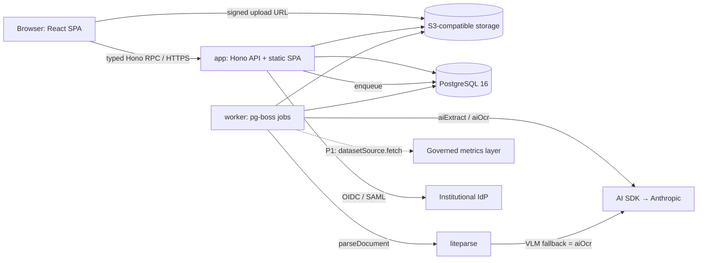

# Architecture

How AMS works — system structure, data model, key patterns, and the decisions behind them. Living document: update it when structure changes and link rationale to [DECISIONS.md](DECISIONS.md). The full specification is [docs/PRD.md](docs/PRD.md).

---

## System overview



- **app** — Hono on Node. The only entry point for data access. Serves the built SPA. ([DEC-009](DECISIONS.md#DEC-009))
- **worker** — pg-boss jobs: text extraction/OCR, AI extraction, exports (DOCX/PDF/XLSX/ZIP), notifications, dataset refresh. Same transaction helper and identity rules as the API. ([DEC-010](DECISIONS.md#DEC-010))
- **PostgreSQL** — single database; RLS, immutability and audit triggers, job queue. ([DEC-007](DECISIONS.md#DEC-007))
- **Object storage** — any S3-compatible service; private buckets; SHA-256 per object. ([DEC-008](DECISIONS.md#DEC-008))
- **External** — institutional IdP (OIDC/SAML), AI provider (framework documents only), and in P1 the governed metrics layer. ([DEC-013](DECISIONS.md#DEC-013), [DEC-014](DECISIONS.md#DEC-014))

### Repository layout

```
apps/web         React SPA (Vite) — UI only
apps/api         Hono routes, middleware, OpenAPI
apps/worker      pg-boss job handlers
packages/core    service modules: org, framework, engagement, evidence, reports,
                 responses, decisions, compiler, assessment
packages/db      Drizzle schema, SQL migrations (RLS, triggers), fixtures
packages/shared  Zod schemas and types
docs/PRD.md      specification;  docs/{vision,roadmap,tasks,decisions}/  VEF records
```

## Data model

Full field lists: PRD §6. The shape:

- **Organization & access** — institution → org_unit tree → program; app_user; role_assignment (role × scope: institution / org_unit / program / engagement; `engagement_lead` exactly one per engagement).
- **Framework library** — accreditor → framework → framework_version (config: level labels, lifecycle template, decision/finding/response vocabularies, rating method) → requirement tree + requirement_note (authority-classified) + report_template; source_document → source_page (text, method, parser version). Published versions are immutable.
- **Engagements** — engagement (subject × framework_version, lead, key dates) → milestone (roadmap copy, origin, locked) and engagement_requirement (owner, status, applicability).
- **Evidence** — evidence_item → evidence_version (file or dataset rows + lineage) → evidence_link (to engagement_requirement, rationale required, reviewed); dataset_spec for datasets (source_kind manual_upload | governed_metric).
- **Reports** — report (round_no, revises_report_id, responds_to_response_id) → report_section (block type, dataset_binding) → attestation → submission_snapshot (immutable manifest).
- **Responses & decisions** — accreditor_response (document required) → feedback_item (verbatim, category, severity, carried_from) → action; accreditation_status (append-only official record).
- **Shared** — comment, audit_event (append-only), job, extraction_item (AI proposals).
- **Tenancy** — every row carries institution_id; RLS keys on it.
- **Framework library (M1)** — `packages/core/src/framework/` (versions, tree, notes, templates, sources, import/export); configuration schemas in `packages/shared/src/framework.ts`; immutability and the publish gate are database triggers (migration 0005). Fixtures in `packages/db/fixtures/`.

Invariants (PRD §6.9) are enforced by triggers and constraints, not by convention.

## Key patterns

- **Frameworks as configuration** — no accreditor-specific code. ([DEC-002](DECISIONS.md#DEC-002))
- **Lifecycle template → editable engagement roadmap**, locked milestones, reviewed template updates. ([DEC-003](DECISIONS.md#DEC-003))
- **Response sub-cycle** — submit → response → items → resolve → reply/revise → close. ([DEC-004](DECISIONS.md#DEC-004))
- **Store once, link with a reason** — evidence and datasets are institutional assets; snapshots freeze values. ([DEC-014](DECISIONS.md#DEC-014))
- **Proposal tables for AI** — AI writes proposals; humans accept; deterministic quote verification. ([DEC-006](DECISIONS.md#DEC-006))
- **One import point per heavy library** — `parseDocument()`, `aiExtract()/aiOcr()`, `datasetSource.fetch()`. ([DEC-011](DECISIONS.md#DEC-011), [DEC-012](DECISIONS.md#DEC-012))

## Cross-cutting concerns

- **Request chain** — authenticate → authorize (`requires`) → transaction with `SET LOCAL` identity → validate → handle; enforced at route registration and in CI. ([DEC-010](DECISIONS.md#DEC-010))
- **Authentication** — Better Auth, OIDC/SAML SSO, password fallback; sessions in PostgreSQL. ([DEC-015](DECISIONS.md#DEC-015))
- **Authorization** — permission service + PostgreSQL RLS (defence in depth).
- **Audit** — trigger-written, append-only, actor from session settings (user, system or AI identity).
- **Files** — signed upload/download URLs issued after permission checks; confidentiality respected.
- **Internationalisation** — Arabic and English content, RTL rendering; UI English first.
- **Observability** — JSON logs to stdout; OpenTelemetry-compatible.

## Architectural decisions

DEC-002 frameworks as configuration · DEC-003 lifecycle and roadmaps · DEC-004 response sub-cycle · DEC-005 official vs internal · DEC-006 authority + quote verification · DEC-007 single PostgreSQL · DEC-008 host-agnostic · DEC-009 SPA + Hono · DEC-010 middleware chain · DEC-011 liteparse · DEC-012 AI SDK · DEC-013 AI data handling · DEC-014 dataset evidence · DEC-015 Better Auth. See [DECISIONS.md](DECISIONS.md).

## How to update this document

- New component or service → **System overview**. New table or relationship → **Data model** (and the PRD if the owner approves).
- Architectural decision → `/decisions add`, then link it here.
- Run `vef setup` after direct canonical edits and `vef check` before committing.
